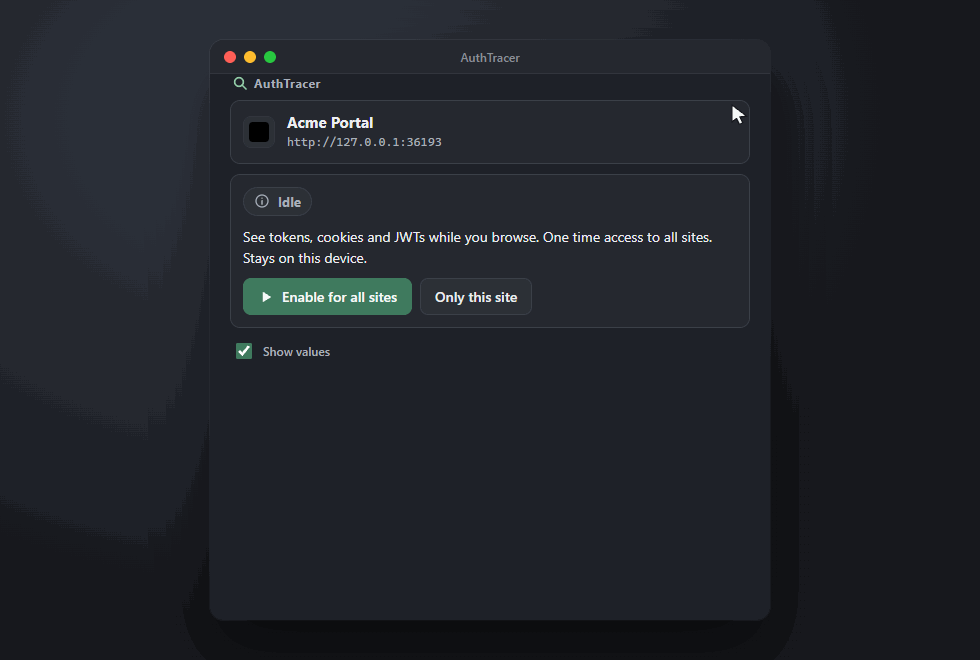

<p align="center">
  
</p>

<h1 align="center">AuthTracer</h1>

<p align="center">A browser extension that shows which authentication signals a website is actually sending while you use it: session cookies, bearer tokens, JWTs, API keys and CSRF tokens. Built for security testers who want that information at a glance, without opening DevTools every time.</p>


<!-- Replace with your own screen recording whenever you have one -->

## Why

During a pentest or a security review, you often need a quick answer to one question: what is this site using to keep me signed in. Checking manually means opening the network tab, filtering requests, and reading headers one by one. AuthTracer watches the traffic for you and summarizes it in the popup.

Everything runs locally in the browser. Nothing is sent anywhere, there is no telemetry, and no request is ever modified or replayed.

## Features

- Detects Authorization headers, session cookies, API keys, CSRF tokens and JWTs
- Decodes JWTs and flags unsigned tokens or expired ones
- Groups results by how likely each item is to be a real credential
- Works across every tab at once, or scoped to a single site
- Cookie attributes (Secure, HttpOnly, SameSite) shown next to each cookie
- Copy a sanitized summary, a full report with values, or structured JSON
- Exports cookies in a format compatible with Cookie-Editor's import
- Values stay hidden until you explicitly turn them on

## Install

Not published in the Chrome Web Store or Edge Add-ons yet, so it loads as an unpacked extension. Chrome and Edge block one click installs from outside their stores on purpose, as a security measure, so this always takes a few manual steps.

**1. Get the extension**

Download the [latest release](https://github.com/infat0x/authtracer/releases/latest) and extract the zip, or clone this repository if you want the source.

**2. Load it**

Chrome
1. Open `chrome://extensions`
2. Turn on Developer mode
3. Click Load unpacked and select the extracted `authtracer` folder (or the `extension` folder if you cloned the repository)
4. Pin AuthTracer from the extensions menu

Edge
1. Open `edge://extensions`
2. Turn on Developer mode
3. Click Load unpacked and select the same folder

Other Chromium browsers (Brave, Opera, Vivaldi) use the same steps. Firefox and Safari are not supported, since they need a different manifest and background model.

## Usage

1. Click the extension icon and press **Enable for all sites**. The browser asks for permission once.
2. Browse normally. Every tab is tracked on its own, no further clicks needed.
3. Click any row to expand it and see the value, copy it, or decode a JWT.
4. Use the **Export** button to copy a summary, copy structured JSON, or download a file.
5. Turn **Show values** off at any time to stop keeping real values in memory.

A narrower **Only this site** mode is also available, scoped to one tab and one origin.

## Permissions

| Permission | Why it is needed |
|---|---|
| `webRequest` | Read request header names as they are sent. Nothing is blocked or modified. |
| `cookies` | Read cookie attributes for the active site. |
| `storage` | Keep the current session's results so the popup survives being closed and reopened. |
| `tabs` | Read the active tab's title, URL and favicon, and detect navigation. |
| `favicon` | Show the site icon from the browser's own cache, with no extra network request. |
| Host permissions | Requested only when you enable the extension, for the sites you choose. Released when you turn it off. |

## Development

Requires Node 22 and a Playwright Chromium build (`npx playwright install chromium`).

```
npm install
npm run test:unit
npm run test:e2e
```

The project structure:

```
extension/        the extension itself (manifest, background script, popup)
extension/lib/     signal classification and formatting, no browser APIs
tests/             unit tests and an end to end suite against a local fixture
tools/             scripts that build the toolbar icons and the demo GIF
```

## Limitations

- Chromium based browsers only
- A request served from cache, or made by another extension, may not be visible to `webRequest`
- Cookie values refresh live once values are shown, but a header value already seen before that point needs a new request to capture
- A header whose name merely looks like a credential is shown as unclear rather than a confirmed one

## License

MIT, see [LICENSE](LICENSE).
